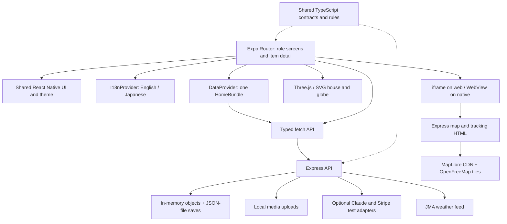

# KAKEHASHI architecture audit — Stage 0

Audit date: 15 October 2026 (Asia/Kuala_Lumpur). Repository: `D:\kakehashi\Kakehashi`. Baseline HEAD: `8c9692a40214d3fbdd4f8221fc062274fb178fda`.

This assessment is based on the repository source, installed package manifests, and the executed checks recorded in [progress.md](progress.md). It is not an end-to-end certification. No application source, dependencies, configuration, or existing data was changed. The pre-existing `package-lock.json` modification was preserved. No applicable `AGENTS.md` was found in the repository or its workspace ancestors. No equivalent EverCircle documents existed.

## Architecture and deployment

The root `package.json` defines an npm workspace with `apps/mobile`, `apps/server`, and `packages/shared`. It is already the appropriate container for EverCircle. Keep React Native, Expo, Expo Router, TypeScript, Express, and the shared package.

Local development uses `concurrently` to run `tsx watch src/index.ts` and `expo start`. Express defaults to port 4100; the README describes Expo on 8081. Hosted deployment in `render.yaml` runs `npm ci --include=dev && npm run build:hosted` and `npm run start:hosted`, with `EXPO_PUBLIC_API_URL=same-origin`. Express serves mobile `dist` and a single-page fallback after API/HTML routes (`apps/server/src/index.ts:958`). The baseline export used the current environment, not a specifically injected same-origin setting; deployment/API connectivity was not exercised.

## Verified dependencies and configuration

Declared versions and installed versions differ within permitted ranges. Installed versions below come from `npm.cmd ls --depth=0`, not guesses based on the README.

| Layer | Declared examples | Installed baseline |
| --- | --- | --- |
| Runtime | Node >=20.19; Render Node 22 | Node 24.20.0, npm 11.19.0 on Windows |
| App | Expo ^57.0.26; Router ~57.0.24 | Expo 57.0.27, Router 57.0.25 |
| React | React/React DOM 19.2.3; RN ^0.86.3 | React/DOM 19.2.3; RN 0.86.3, root overrides |
| Native/web bridges | RN Web ^0.21.2, WebView 13.16.1, SVG 15.15.4 | RN Web 0.21.4, WebView 13.16.1, SVG 15.15.4 |
| Visualization | Three ^0.186.1, Fiber ^9.8.1, Expo GL ~57.0.2 | Three 0.186.1, Fiber 9.8.1, Expo GL 57.0.2 |
| Media | Expo Audio/Image Picker/Location | 57.0.5 / 57.0.20 / 57.0.20 |
| Fonts | Zen Kaku Gothic New / Shippori Mincho | 0.4.2 / 0.4.1 |
| Server | Express ^4.21.0, tsx ^4.19.0 | Express 4.22.3, tsx 4.23.15 |
| Optional providers | Anthropic SDK ^0.133.0, Stripe ^23.0.0, sharp ^0.35.5 | 0.133.0 / 23.0.0 / 0.35.5 |
| Compiler | TypeScript ^5.6.0 | 5.9.3 |

Other app dependencies include safe-area-context, screens, linking, constants, font loading, status bar, and web-browser. Server dependencies include CORS and dotenv. No application-level Redux, Zustand, query-cache, authentication, AI-chat, speech recognition, notification, or home-device integration is declared. Fiber depends transitively on Zustand; the app does not use it for domain state. Do not treat a transitive package as a chosen application dependency.

`apps/mobile/app.json` names KAKEHASHI, scheme `kakehashi`, locks orientation to portrait, forces light appearance, selects Metro and single-page web output, and disables typed routes. Plugins configure Router, fonts, microphone, photos/camera, and foreground location permission copy. There are no committed native `ios`/`android` projects or EAS configuration in the inspected file inventory. `babel.config.js` uses `babel-preset-expo`; mobile extends Expo's strict TS base. Server uses strict ES2022/Bundler resolution with `noEmit`, including shared sources. The shared package exports TypeScript source directly and has no build/typecheck script of its own; both workspace type checks cover its imports.

## Navigation and component architecture

`apps/mobile/app/_layout.tsx` waits for five font weights, mounts `I18nProvider` outside `DataProvider`, and renders a headerless root `Stack`. It injects web-only thin-scrollbar CSS and sets a light StatusBar. There is no explicit font-load error fallback; an unsuccessful load can leave an empty root. Safe-area insets are read in `TopBar` and `Toast`; the screen body does not explicitly apply bottom insets.

`app/index.tsx` is a five-role demo picker: older adult (`/her`), family, students, helpers (`/worker`), public story readers. Family and student each have a four-tab layout. Other routes are standalone root-stack screens. `item/[id].tsx` changes editable controls when `?as=student` is present; that parameter is a presentation switch, not authorization. The full inventory and important query parameters are in [feature-inventory.md](feature-inventory.md).

`src/ui.tsx` exports `Screen`, `TopBar`, `LangToggle`, `NightBand`, `Columns`, `useWide`, `Heading`, `Card`, `Fold`, `ReadConfirm`, `Button`, `DecisionChip`, `Pill`, `Glyph`, `Field`, `Avatar`, and `formatDate`. `ScrollPanel` and `Toast` are internal. `Screen` depends on legacy `useData`: it suppresses all children on a home-load error or missing bundle. This makes even the public story screen dependent on loading the private demo home. Avoid copying this dependency into EverCircle's independent loading/error states.

Layouts stack below 900 px and use two columns at 900 px or more; maximum width is 640 or 1120. `fit` changes from page scrolling to independently scrolling panels. This recent design is documented in `docs/superpowers/specs/2026-10-14-night-band-layout-design.md`, including its update extending two columns to her screen. Those documents are historical evidence; current source is authoritative.

`src/theme.ts` contains static colors, fonts, text styles, decision/room mappings, and currency formatting. Decision meaning is shared throughout the interface: moss keep, plum family, indigo pass, persimmon recycle, open means not now. Preserve meaning even if presentation changes. Spacing, radii, control size, focus, and appearance variants are largely inline rather than centralized.

## State and data flow

`src/data.tsx:6` fixes `HOME_ID='tanaka'`. `DataProvider` owns `HomeBundle | null`, a fetch error, and a transient toast. It fetches once on mount and on explicit `refresh()`. `replaceItem()` replaces or appends an item locally; most non-item mutations refetch the entire home. There is no general request cancellation, stale-response protection, persistent offline queue, normalized cache, selected-role session, or tenant selection. Context values are recreated when data or toast changes.

Wallet, helper jobs, weather, public stories, editing drafts, folds, visit steps, and visualization settings use component state. Weather hooks fetch periodically every ten minutes; maps poll live outing data; legacy home state is not continuously synchronized across devices. State inside conditionally mounted student steps/folds can disappear on unmount. An outing watcher explicitly stops on unmount, so a visually harmless fold/navigation change can affect location reporting (`src/Outing.tsx:31`). Keep these lifecycle semantics visible during redesign.

The proposed approach is a separate module-scoped EverCircle reducer/context plus an explicit read-only selector bridge from `HomeBundle`. Keep the existing `DataProvider`, API semantics, and legacy DTOs stable initially. See [integration-plan.md](integration-plan.md) for ownership, persistence, and consent rules.

## API and server behavior

`src/api.ts` resolves an explicit `EXPO_PUBLIC_API_URL` first; `same-origin` uses browser origin; otherwise web uses the current hostname on 4100 and native uses Expo host URI or localhost. It exposes typed JSON-fetch functions and helpers for file/letter URLs. Requests have no auth headers, runtime response validation, abort signal, or timeout. Invalid successful JSON can resolve as an empty object. `uriToBase64()` uses fetch/blob/FileReader for captured media; native file-URI support needs physical-device validation before reuse for new voice features.

| Domain | API functions and server route families |
| --- | --- |
| Home/consent | `home`, `consent`, `proceeds`; `/api/home/:id`, `/consent`, `/proceeds` |
| Items/memories | `addItem`, `update`, `wish`, `audio`, `addPhoto`, `setIcon`, `handover`, `startDelivery`, `estimate`; `/api/items*`, `/api/estimate` |
| Safety/house future | `addFix`, `fixStatus`, `houseWish`, `houseNote`, `houseCondition`, `houseStep`; `/api/home/:id/safety*`, `/future/*` |
| Community/location | `activity`, `startOuting`, `outingFix`, `endOuting`; `/activities/:aid`, `/outings*`; map-only `/outings/live` |
| Helpers | `askHelp`, `postJob`, `bookHelp`, `helpStatus`, `jobs`, `acceptJob`; `/services*`, `/api/jobs*` |
| Public stories | `stories`, `storyComment`, `storyHeart`, `shareStory`, `moderate`; `/api/stories*`, item `/share` and `/comments/:cid` |
| Visits/team | `addFieldNote`, `checkReport`, `sendReport`, `studentStep`, `roomPhoto`; `/fieldnotes`, `/api/report/check`, `/report`, `/students/:sid/step`, `/rooms/:rid/photos` |
| Touchpoints | `prepareLetter`, `letterStatus`, `logCall`; `/letters`, `/api/letters/:id/status`, `/calls` |
| Weather/wallet/payment | `weather`, `weatherCheck`, `weatherDemo`, `wallet`, `setGoal`, `payout`, `checkout`; `/weather*`, student `/wallet`, `/goal`, `/payout`, `/api/checkout` |

All callable API groups above were matched to source handlers. Exception: `api.tag()` calls `/api/items/:id/tag`, but no corresponding handler or UI call was found. It is not evidence of a working public tag feature.

`apps/server/src/index.ts` is a roughly 51 KB monolithic route module. Express enables unrestricted CORS, accepts 20 MB JSON bodies, serves `/files` from uploads, and listens on `0.0.0.0`. There is no authentication or authorization middleware. Object IDs, author names, worker selection, and student parameters are client-provided. Validation exists for many business transitions, but it does not establish actor identity.

`db.ts` creates uploads on import, reads one JSON file into memory, and saves synchronously via a temporary file and rename. Its `isCurrent` check mixes schema checks with demo-state predicates: it requires some open service, some shared item, and some delivery. Legitimate completion/withdrawal of all such records can trigger reseeding at the next startup. It is not a safe migration framework. `reset()` resets homes/items but not examples/uploads. Avoid starting/resetting the server merely for audit, and do not add EverCircle's records to these reseed predicates.

`seed.ts` supplies the example household, students, workers, rooms, fixes, outings, plans, item journeys, and invented public stories. `nearby.ts` contains a static copied list of OpenStreetMap places rather than live place search. `mapPage.ts` and `trackPage.ts` generate MapLibre pages using a pinned CDN script and remote tiles; they have their own CSS, color values, and text sizes. Their accessibility cannot be fixed solely by changing mobile theme tokens.

## Existing AI, payments, and consent boundaries

`estimate.ts` optionally sends a photo to Anthropic; no key or no photo takes an offline rules path. `pressure.ts` optionally checks report wording and falls back to an English/Japanese word list on provider failure. The configured model/beta strings and `as any` SDK call are observed code, not validated provider compatibility. No provider call was made. Letters are assembled deterministically from existing records; an AI letter-generation service was not found, despite broader README language.

`payments.ts` permits only `sk_test_` keys; absent or other keys produce demo mode. Student payout is a stored demonstration status update, not a bank transfer. Keep both visibly labelled. No checkout/payout was executed during Stage 0.

Verified protections to preserve:

- New items default to `open`; letting-go decisions set a hold date until the next planned visit. Delivery/handover handlers check holds.
- Audio upload is rejected without `home.consent.recording`.
- Report sending requires `readConfirmed === true` and re-runs the wording check. Print status requires human read confirmation.
- Job posting requires price agreement; helper listing/acceptance validates clearance and skills. Sign-off requires all prior readiness steps.
- Outing creation requires `consent === true` and an accepted activity. Fixes are rejected after ending, for a simulated outing, or >30 km from home. Explicit ending deletes trail/last point; the four-hour timeout is processed lazily during outing requests, not by a timer. Sweeps on read routes do not themselves save the cleared data immediately.
- Public story projection filters to shared stories, omits private journey names/coordinates, rounds location to 0.1 degrees, and includes only permitted item photographs. Comments require moderation and reject contact patterns.

Limits: story sharing checks content and media availability but has no independent consent receipt; a student-facing agreement button records intent. Media URLs are statically accessible without role checks; withdrawing sharing does not revoke already copied URLs. Read confirmation is specifically checked for printing, but the letter handler permits a direct `mailed` transition without that check. UI actor modes and demo helper checks are not security boundaries. These are release gates for real EverCircle personal data, not reasons to rewrite the backend during the initial frontend work.

The README's old rule that AI never talks to her will need an explicit product-policy update when a direct AI companion is introduced. Preserve the underlying senior autonomy and human review commitments; do not silently interpret recording consent as consent to AI conversations or matching.

## Localization

`src/i18n.tsx` has English keys, `Key=keyof typeof en`, Japanese `Record<Key,string>`, a provider, and `{variable}` substitution with English fallback. `pick()` in shared handles optional bilingual domain content. Language persists to web localStorage (`kakehashi-lang`) with safe fallback; no native persistent language storage is implemented. UI copy is mostly localized, but fallback errors, the role-picker headline, iframe labels, room-photo labels, plan descriptions, estimator reasons, and printable letter layout contain fixed-language content. Editing stories/reports/notes intentionally clears stale Japanese translations. Console mojibake from default PowerShell decoding is not proof of corrupt source; UTF-8 source search returned readable Japanese.

## Assessment

The best integration seam is new Expo routes and feature modules, with read-only reuse of existing memories, rooms, activities, and visit information. There is no need for another application, Vite, a global state-library migration, or backend refactor to demonstrate the eight requested capabilities. Real multi-user matching, durable private memory, AI conversation history, and device control require targeted identity/consent/storage work later. Successful type checks and export are a sound compiler baseline, but leave runtime accessibility, native permissions, provider availability, and deployment connectivity unverified.
